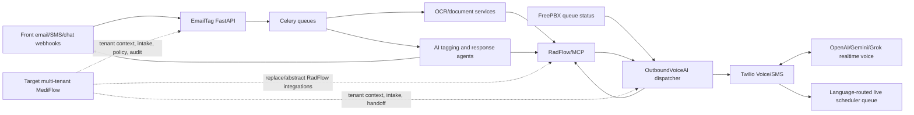

# MediFlow Technical Handoff: RadFlow/EmailTag Logic, Rules, OCR, Routing, AI, Agents, and Training

**Repositories reviewed:** `/home/fret/work/emailtag`, `/home/fret/work/OutboundVoiceAI`, and the isolated v2 worktree `/home/fret/work/OutboundVoiceAI-v2`

**Review date:** July 23, 2026

**Purpose:** Provide the MediFlow team with a comprehensive, code-referenced description of the current RadFlow/EmailTag implementation and identify what must change for a secure multi-tenant product.

Unless otherwise stated, `app/...`, `training/...`, and `docs/...` paths refer to the EmailTag repository. Voice paths are written as `../OutboundVoiceAI/...` for the production/main implementation and `../OutboundVoiceAI-v2/...` for v2 design and feature-gated development.

## 1. Executive summary

EmailTag is an inbound communications automation system centered on Front. It receives inbound Front webhooks, stores message state in PostgreSQL, processes attachments through a document-analysis queue, classifies conversations with hierarchical OpenAI prompts, applies Front tags, optionally routes conversations to Front inboxes, and dispatches tag-specific response agents.

The current platform includes:

- Email, SMS, chat, and fax-like message handling to the extent that Front presents them as conversations/messages.
- Attachment classification and extraction commonly referred to in the code as “OCR.”
- Specialized lien analysis: barcode parsing, patient ID extraction, lien type detection, signature classification, document splitting, modification detection, and upload to RadFlow.
- Hierarchical AI tagging backed by version-controlled prompt/rule files.
- Topic-change detection and optional conversation splitting.
- Conservative automated archiving with a second-opinion AI verification step.
- Patient and study lookups through a local MCP service.
- Automated or templated responses for selected tags.
- Human-review escalation for ambiguous, unsafe, unauthorized, or unsupported cases.

The current implementation is **not multi-tenant**. Core configuration, credentials, prompts, templates, inbox mappings, identifiers, branding, and database records are globally scoped or Precise Imaging/RadFlow-specific.

Voice is implemented in the companion `../OutboundVoiceAI` repository. It is an outbound scheduling-availability agent that protects inbound scheduling capacity, places calls through Twilio, streams audio to a selectable realtime AI provider, detects voicemail/carrier failures, sends callback SMS messages, and transfers available patients to a language-appropriate live scheduling queue. It does not currently schedule appointments itself or conduct the full MediFlow intake workflow.

The separate `../OutboundVoiceAI-v2` worktree contains feature-gated MediFlow intake design and development. Its own documentation states that v2 work is isolated from the production/main worktree and uses a separate database. The consent/gating scaffolding visible in current source must not be confused with a fully released voice-intake system.

The deployed classifier does **not** appear to use a repository-contained fine-tuned model. “Training” primarily means collecting labeled Front conversations, generating/refining prompt rules, using few-shot examples, and evaluating classification accuracy.

## 2. System architecture

### 2.1 Runtime components

| Component | Purpose | Primary code/configuration |
|---|---|---|
| FastAPI | Webhooks, APIs, admin endpoints, health checks | `app/main.py::create_application` |
| PostgreSQL / SQLAlchemy | Email state, tags, settings, templates, traces, and agent events | `app/models/`, `app/db/`, `app/crud/` |
| Alembic | Schema migrations | `migrations/` |
| Celery | Asynchronous message, OCR, tagging, and response processing | `app/tasks/worker.py` |
| RabbitMQ | Celery message broker | `docker-compose.yml` |
| Front API | Conversation retrieval, tagging, replies, archive, split, routing | `app/services/frontapp_service.py` |
| OpenAI | Classification, structured extraction, vision analysis, archiving decisions, agent reasoning | `app/services/`, `app/agents/` |
| MCP service | RadFlow-facing patient, study, billing, document, and logging tools | `app/mcp.py` |
| Next.js | Modern settings/admin interface | `frontend/settings2/` |
| Flower | Celery monitoring | `docker-compose.yml` |

The main application assembly is in:

- `app/main.py::create_application` (around line 52)
- `app/api/api_v1/api.py` for v1 router registration

### 2.2 Celery queues

Queue routing is defined in `app/tasks/worker.py`:

| Queue | Main responsibilities |
|---|---|
| `emails` | Initial email processing |
| `ocr` | Attachment download and document analysis |
| `processing` | Post-OCR orchestration, autorespond, and audits |
| `tagging` | Hierarchical classification and Front tagging |

Docker Compose runs separate workers for live processing and OCR. This separation is important because document analysis can be much slower than ordinary message processing.

Relevant files:

- `app/tasks/worker.py`
- `app/core/celery_config.py`
- `docker-compose.yml`

### 2.3 Current system boundaries



EmailTag and OutboundVoiceAI are currently separate applications with separate lifecycle and persistence concerns. The target should establish shared tenant identity and neutral MediFlow service contracts without casually merging their worker loops, databases, or failure domains.

## 3. End-to-end inbound workflow

### 3.1 Front webhook intake

The primary entry point is:

- `app/api/api_v1/endpoints/webhooks.py::frontapp_webhook` (around line 73)
- `app/api/api_v1/endpoints/webhooks.py::process_inbound_message` (around line 176)

The intake flow:

1. Read and parse the raw Front webhook body.
2. Construct a `FrontAppWebhook` Pydantic object.
3. Create a processing trace for the Front conversation.
4. Accept `inbound` and `custom` webhook event types.
5. Ignore other event types.
6. Extract the conversation ID, sender, subject, recipients, body, and attachments.
7. Detect the system’s invisible autoresponse marker or configured autoresponse signature to prevent bot loops.
8. Store the email and raw webhook data.
9. Extract patient information where possible.
10. Queue `app.tasks.email.process_email`.

The overall inbound-processing switch is `IS_AUTO_ENABLED` in `app/core/config.py`. When disabled, the webhook can be received without continuing into the automated pipeline.

### 3.2 Initial message processing and OCR decision

The task is:

- `app/tasks/email.py::process_email` (around line 329)

The task:

1. Validates the email UUID.
2. Loads the stored email record.
3. Checks for incomplete OCR work from earlier emails in the same conversation.
4. Determines whether attachments require document processing.
5. Marks the email `pending_ocr` and records expected/completed attachment counts.
6. Queues one OCR/document-processing task per attachment on the `ocr` queue.
7. If there are no usable attachments, queues post-OCR orchestration directly.

The attachment task is:

- `app/tasks/document_processing.py::send_attachment_to_document_processing`

Despite the queue name, this task runs the generalized document-analysis service rather than only traditional OCR.

### 3.3 Post-OCR orchestration

The task is:

- `app/tasks/email.py::orchestrate_post_ocr_processing` (around line 494)

Its documented order is:

1. Fetch email state.
2. Check whether the new message changes the conversation topic.
3. Split the conversation when appropriate.
4. Check whether the conversation is fully resolved and safe to archive.
5. Extract patient IDs before classification.
6. Queue hierarchical tagging when the conversation was neither split nor archived.

### 3.4 Topic-change detection and conversation splitting

Topic analysis is implemented in:

- `app/services/topic_analysis_service.py`
- `app/tasks/email.py`, topic-split block beginning near line 545
- `app/services/frontapp_service.py::create_new_conversation_for_split` (around line 1838)

The system:

1. Retrieves existing Front tags.
2. Filters out non-classification/system tags.
3. Uses the existing classification tag as the current topic.
4. Retrieves recent structured conversation history.
5. Compares the new message against the current topic.
6. Uses a structured OpenAI result containing a split decision, confidence, rationale, and suggested new leaf tag.
7. Creates a new Front conversation when a split is recommended.
8. Adds `System: Split - New Topic` to the original conversation.
9. Validates and applies the suggested leaf tag to the new conversation.

The number of history messages is controlled by `TOPIC_SPLIT_MESSAGE_HISTORY_COUNT`.

### 3.5 Automated archiving

The service is:

- `app/services/archiving_service.py::check_and_archive_conversation` (around line 194)
- `app/services/openai_service.py::are_questions_resolved_openai`
- `app/services/openai_service.py::verify_archive_decision_openai`
- `app/services/frontapp_service.py::archive_conversation_in_front` (around line 551)

The archive workflow is deliberately conservative:

1. Check stored attachment-analysis results.
2. Prevent archiving when an actionable document type is present with sufficient confidence.
3. Re-download and reprocess the latest email’s attachments as an independent document check.
4. Analyze the structured Front message chain for unresolved questions, requests, or promised actions.
5. If the first analysis recommends archive, run a skeptical second-opinion model against freshly fetched Front data.
6. Archive only when the verification also recommends proceeding.

All document types other than `other` are treated as actionable in the pre-archive document check when confidence is above the configured logic threshold.

### 3.6 Patient ID extraction

Primary functions:

- `app/agents/agent_helpers.py::extract_patient_id_from_email_logic`
- `app/agents/agent_helpers.py::extract_all_patient_ids_from_email_logic` (around line 963)
- `app/helpers/patient_extraction.py`

Extraction sources include:

- Explicit `PRE...` patient IDs in subject/body/history.
- Forwarded-message content after signature/footer cleanup.
- Structured OpenAI extraction of patient name, DOB, DOI, phone, and patient identifiers.
- Attachment document analysis.
- Lien barcodes.

Extracted IDs are stored on the email record and may also be posted to Front as internal comments.

## 4. AI classification and tagging

### 4.1 Hierarchical classifier

The primary implementation is:

- `app/services/classification_service.py::classify_email_tags_hierarchical` (around line 1037)
- `app/services/classification_service.py::_call_llm_for_classification`
- `app/services/file_based_rules_service.py`
- `app/tasks/email.py::perform_tagging_task` (around line 865)

The hierarchy comes from `EMAIL_CATEGORIES` in `app/core/config.py` and the environment. The current hierarchy is:

```text
Scheduling
├── RX
│   ├── Order Pending
│   ├── Incomplete
│   ├── RX
│   ├── Apt status req
│   ├── No Show
│   └── Cash Patient
├── Cancel Request
├── Reschedule Request
├── Scheduling request
└── Will contact patient

Medical Records & Images
├── Release of Records
├── Image Request
├── CD Requests
├── Reports Request
├── US Tech Sheet
├── Portal Requests
├── Referral pad request
├── Incorrect patient info
├── Incorrect study info
├── Patient Demo
└── ID Mismatch

Accounts Receivable
├── Billing
│   └── Bill or balance Request
├── Liens
│   ├── Missing Lien Request
│   ├── PSL
│   │   ├── Rad Lien
│   │   ├── Tech Lien
│   │   └── Lien Modified
│   └── ASL
│       ├── Rad Lien
│       ├── Tech Lien
│       └── Lien Modified
├── Negotiations
│   ├── Bill Offer
│   ├── Pending Approval
│   └── Counter Offer Sent
├── Case Updates
│   ├── New Attorney
│   ├── Drop Letter
│   ├── Drop Pending
│   ├── Promise to send payment
│   ├── Waiting to clear liability
│   ├── Waiting on settlement check
│   ├── Sent payment but not received
│   ├── Refund Request
│   └── Payment on way
├── Collections
│   ├── To send to collections
│   ├── Attorney Non-Payment
│   └── To Review
└── Process CC

No Tag
```

At each dictionary level:

1. The service loads the prompt file corresponding to the current path.
2. Valid children become a constrained enum in the OpenAI structured-output schema.
3. The model must return `chosen_option`, `conversation_summary`, and `reason`.
4. The classifier traverses until it reaches a string or list leaf.
5. Liens return both the signature-family tag (`PSL` or `ASL`) and the leaf lien type.
6. Invalid output or a missing prompt falls back to `AI: Human review required`.

### 4.2 Live prompt/rule files

The live file-based rules are:

- `app/prompts/rules/ROOT.txt`
- `app/prompts/rules/ROOT_SCHEDULING.txt`
- `app/prompts/rules/ROOT_SCHEDULING_RX.txt`
- `app/prompts/rules/ROOT_MEDICAL_RECORDS_AND_IMAGES.txt`
- `app/prompts/rules/ROOT_ACCOUNTS_RECEIVABLE.txt`
- `app/prompts/rules/ROOT_ACCOUNTS_RECEIVABLE_LIENS.txt`
- `app/prompts/rules/ROOT_ACCOUNTS_RECEIVABLE_LIENS_ASL.txt`
- `app/prompts/rules/ROOT_ACCOUNTS_RECEIVABLE_LIENS_PSL.txt`
- `app/prompts/rules/ROOT_ACCOUNTS_RECEIVABLE_NEGOTIATIONS.txt`
- `app/prompts/rules/ROOT_ACCOUNTS_RECEIVABLE_CASE_UPDATES.txt`
- `app/prompts/rules/ROOT_ACCOUNTS_RECEIVABLE_COLLECTIONS.txt`
- `app/prompts/rules/ROOT_ACCOUNTS_RECEIVABLE_PROCESS_CC.txt`

The older combined top-level rule document is:

- `app/prompts/classification_rules.txt`

The file-based service should be treated as the production source of truth unless a deployment has intentionally switched to database-backed rules.

### 4.3 Conflict detection

The pre-classification conflict check is:

- `app/services/classification_service.py::_check_for_conflicting_top_level_topics` (around line 818)

Behavior:

- Detects requests that span incompatible top-level categories.
- Returns `AI: Human review required` when meaningful conflicts exist.
- Skips this check when an actual RX document has already been identified.
- Can be disabled using `CONFLICT_DETECTION_ENABLED`.
- Proceeds with normal classification if the conflict check itself fails.

### 4.4 Tag conflict removal

Tag cleanup is implemented in:

- `app/services/classification_service.py::remove_conflicting_tags` (around line 1299)
- `app/services/frontapp_service.py::remove_conversation_tags` (around line 843)

The system builds the full classification tag set from `EMAIL_CATEGORIES`, preserves non-classification/system tags, removes incompatible prior classification tags from Front, and then applies the newly determined tags.

### 4.5 Front tag application and local persistence

Relevant code:

- `app/tasks/email.py::perform_tagging_task`
- `app/services/frontapp_service.py::add_conversation_tags` (around line 653)
- `app/models/email.py`

The task:

1. Retrieves structured conversation content.
2. Retrieves existing Front tags.
3. Runs hierarchical classification with attachment-analysis context.
4. Applies document-specific overrides and screenings.
5. Stores the exact new tag set locally.
6. Uses PostgreSQL `ON CONFLICT DO NOTHING` to tolerate duplicate webhook/task races.
7. Removes incompatible Front tags.
8. Applies new Front tags.
9. Adds supplemental human-review tags where required.
10. Optionally routes the Front conversation.
11. Queues autorespond processing with the newly determined tags.

`No Tag` is a terminal classification: the task skips Front tagging, routing, and autorespond.

### 4.6 Human-review rules

The system may apply `AI: Human review required` when:

- The email contains conflicting top-level requests.
- A rule file is missing or empty.
- The model returns no valid option.
- A lien belongs to another company.
- A lien is expected but barcode/signature data is unreadable or inconclusive.
- A password-protected attachment cannot be analyzed.
- A Portal Request is classified.
- A case-update tag is classified.
- Sender authorization cannot be established.
- Multiple or missing patient matches make disclosure unsafe.
- An agent or required MCP/API call fails.
- A document requires manual credential review.
- A configured human-review-only tag is selected.

The detailed tag gating is in `app/tasks/autorespond.py`, especially the constants and the human-review block beginning around line 337.

## 5. OCR and document-analysis pipeline

### 5.1 What “OCR” means in this repository

The `ocr` queue performs a mixture of:

- File type detection.
- Embedded text extraction.
- PDF-to-image conversion.
- OpenAI vision classification.
- Structured field extraction.
- Barcode decoding.
- Signature detection.
- Document splitting.
- Modification/strikethrough analysis.
- Provider credential extraction.

The main service is:

- `app/services/document_processing_service.py::DocumentProcessingService`
- `app/services/document_processing_service.py::process_document` (around line 603)

### 5.2 Supported file handling

| Input | Handling |
|---|---|
| PDF | PyPDF2 embedded-text extraction; pages rendered to images for vision |
| PNG/JPEG/GIF/BMP/TIFF | Direct image analysis |
| DOCX | ZIP/XML text extraction |
| TXT | Text decoding and metadata |
| Legacy DOC | Explicitly unsupported for detailed extraction |
| XLS/XLSX | Recognized by type detection but not fully processed by the primary detailed path |
| Unknown/ZIP | Marked unsupported unless recognized as an Office container |

Key methods:

- `DocumentProcessingService._determine_document_type`
- `DocumentProcessingService._extract_pdf_text`
- `DocumentProcessingService._extract_docx_text`
- `DocumentProcessingService._analyze_document_with_structured_output`

### 5.3 Document classification labels

OpenAI structured output constrains document classification to:

- `lien`
- `lien_reduction`
- `esign_request`
- `rx`
- `medical_record`
- `hipaa`
- `case_update`
- `bill`
- `patient_demo`
- `other`

The result includes:

- Document type.
- One-line description.
- Patient ID when found.
- Confidence score.

The classification prompt and schema are in `app/services/document_processing_service.py::_analyze_document_with_structured_output`.

### 5.4 PDF and image conversion limits

Current behavior:

- PDFs are rendered at 200 DPI for the initial general classification.
- Pages are converted to JPEG at reduced quality.
- All pages are considered until the combined image payload reaches an internal size limit.
- Very small images are treated as likely logos/letterhead and returned as `other` to reduce false case-update classifications.
- Large images can be rejected before the OpenAI request.

These values are currently implementation constants and should become tenant/platform policy with formal limits.

### 5.5 Enhanced lien processing

Primary orchestration:

- `app/services/lien/enhanced_lien_service.py::EnhancedLienService` (around line 21)
- `app/services/document_processing_service.py::_apply_enhanced_lien_processing`

Component services:

| Function | Code |
|---|---|
| Convert documents into page images | `app/services/lien/document_converter.py` |
| Decode and parse barcodes | `app/services/lien/barcode_detector.py::BarcodeDetector` |
| Detect attorney/patient signatures | `app/services/lien/signature_detector.py::SignatureDetector` |
| Detect cover letters/conditional language | `app/services/lien/cover_letter_detector.py::CoverLetterDetector` |
| Detect owning company | `app/services/lien/company_detector.py::CompanyDetector` |
| Group/split PDFs | `app/services/lien/pdf_splitter.py::PDFSplitter` |

Per page, the enhanced service:

1. Decodes available barcodes.
2. Detects attorney signatures; if none, detects patient signatures.
3. Classifies the page as lien core, cover letter, or other.
4. Detects conditional or modifying language.
5. If no barcode was found, estimates whether the page is a Precise lien that should have a barcode.
6. Retries barcode extraction at alternate DPIs for likely lien pages.
7. Flags expected-but-unreadable barcodes.
8. Runs holistic company detection across lien pages when no `PRE` barcode proves ownership.
9. Builds page groupings.
10. Creates separate PDFs by patient ID, lien type, and signature type.

### 5.6 Barcode processing

Implementation:

- `app/services/lien/barcode_detector.py`

Libraries:

- OpenCV
- pyzbar
- ZXing through `pyzxing`
- Data Matrix support through `pylibdmtx`
- Pillow
- NumPy
- SciPy/scikit-image
- Tesseract in supporting paths

The primary enabled path:

1. Converts the page to grayscale.
2. Runs full-page decoding with pyzbar and ZXing.
3. Tries histogram/morphology variants.
4. Parses caret-delimited barcode payloads into patient ID, document/lien type, and related fields.
5. Recognizes numeric document-type components as patient-demographic documents.

The file contains additional advanced vertical-barcode/heat-map logic. Part of that approach is explicitly disabled because it was considered too slow or unreliable. The alternate-DPI retry in `EnhancedLienService` is the active fallback for likely lien pages.

### 5.7 Signature detection

Implementation:

- `app/services/lien/signature_detector.py`

The service creates:

- Full-page view.
- Bottom-page crop.
- CLAHE-enhanced crop.
- Adaptive-threshold crop.

It then uses two OpenAI Responses API passes:

1. Attorney-only signature detection.
2. Patient-only detection when no attorney signature is found.

Classification:

- Attorney signature found → `ASL`.
- Patient signature found without attorney signature → `PSL`.
- Neither confidently found → `UNKNOWN`.

The service also checks whether a signature is completely outside its designated box. Partial overlap or touching the border is treated as inside.

### 5.8 Lien modification and strikethrough detection

Implementation:

- `app/services/lien_modification_service.py`
- `app/services/pdf_strikethrough_service.py`
- Legacy providers: `app/services/pdf_strikethrough_providers_legacy.py`

The current provider is OpenAI GPT-5.2 vision. It checks:

- Strikethrough text.
- Added attorney information.
- Document quality.
- Whether a detected mark is inside a signature area.

The modification service applies stricter acceptance rules, including minimum readable content and confidence thresholds, before overriding tags with `Lien Modified`.

Google Cloud Document AI and Roboflow providers remain in a legacy module. Their presence does not mean they are active in the current runtime.

### 5.9 OCR-based tag overrides

The override block is in:

- `app/tasks/email.py`, beginning around line 1031

For lien-related initial classifications:

1. Combine enhanced lien data from every attachment.
2. Prefer `ASL` if both ASL and PSL evidence appears.
3. Add every supported lien type found (`Rad Lien`, `Tech Lien`).
4. Add `Patient Demo` when a mixed demographic/lien packet was identified.
5. Fall back to human review when enhanced processing was expected but produced no classifiable lien/signature type.

The system also converts a lien-classified email without an actual lien attachment into `Missing Lien Request` under specific conditions.

### 5.10 RX credential extraction and screening

Implementation:

- `app/services/document_processing_service.py::_extract_rx_provider_credentials`
- `app/services/credential_screening_service.py`
- `docs/CREDENTIAL_SCREENING.md`
- Screening block in `app/tasks/email.py`

For an `rx` document, a second vision request extracts:

- Referring/ordering provider name.
- Prefix.
- Suffix.
- Professional credentials.

The credential-screening service compares normalized credentials with database-configured allowed and disallowed lists. Disallowed or unknown-only credentials add `credential review` and a Front comment. An allowed credential permits normal downstream behavior.

## 6. Routing

### 6.1 Front inbox routing

Implementation:

- `app/tasks/email.py`, routing block beginning around line 1409
- `app/services/frontapp_service.py::move_conversation_to_inbox` (around line 417)
- `INBOX_ROUTING.md`

Configuration:

- `INBOX_ROUTING_ENABLED`
- `TAG_TO_INBOX_MAPPING`

Behavior:

1. Iterate through newly determined tags in order.
2. Select the first tag present in the routing mapping.
3. Patch the Front conversation to the mapped inbox.
4. Attempt routing even if the main tag-application request failed.
5. Skip a hard-coded test channel.
6. Log success, failure, or unmapped tags.

The current inbox IDs and test-channel exclusion are Precise/MediFlow test-instance specific and must not be reused globally in a multi-tenant product.

### 6.2 Routing category summary

The current design routes:

- Scheduling/RX tags to Scheduling.
- Medical Records & Images tags to Records/Reports.
- Billing tags to AR Billing.
- ASL/PSL/Rad/Tech/missing/modified lien tags to AR Liens.
- Negotiation tags to Settlement/Negotiations.
- Case-update tags to AR Case Updates.
- Collections tags to Collections/Status.

The exact existing mapping is deployment configuration, not a portable product default.

## 7. Automated response agents

### 7.1 Agent dispatcher

Primary task:

- `app/tasks/autorespond.py::perform_autorespond_task` (around line 97)

The dispatcher:

1. Checks the database-backed global autorespond setting.
2. Loads email/conversation context.
3. Registers original recipients for correct reply-all behavior.
4. Reads agent test/sandbox modes.
5. Optionally blocks internal-domain senders.
6. Checks the workspace no-action list.
7. Stops on configured human-review-only tags.
8. Selects a tag-specific agent.
9. Records trace data and an autorespond event.
10. Updates final email-processing status.

Effective runtime status is split between environment configuration and database-backed settings. A deployment audit must query both; reading only `AUTORESPOND_ENABLED` from `.env` is not enough to determine whether a particular agent can send.

### 7.2 Agent dispatch matrix

| Trigger tags | Agent | Main implementation | Principal actions |
|---|---|---|---|
| `Apt status req` | Appointment Status | `app/agents/apt_status_req_agent.py::handle_apt_status_request_agent_sdk` | Patient/study lookup, authorization, formatted appointment table, reply/escalate |
| `Release of Records`, `Image Request`, `CD Requests`, `Reports Request` | Medical Records | `app/agents/release_records_autorespond.py::handle_release_of_records_request` | Verify sender, fetch studies, send link/form/template or escalate |
| `Bill or balance Request` | Bill/Balance | `app/agents/bill_balance_request_agent.py::handle_bill_balance_request` | Verify sender, fetch bill/balance, attach documents/templates, reply/escalate |
| `Bill Offer` | Bill Offer | `app/agents/bill_offer_agent.py::handle_bill_offer_request` | Resolve patient, extract offer facts, create intake/review state, optionally reply |
| `Missing Lien Request` | Missing Lien | `app/agents/missing_lien_request_agent.py::handle_missing_lien_request` | Find patient, request missing ID/details once, retrieve e-sign context, escalate |
| Case-update tags | Case Updates | `app/agents/case_updates_agent.py::handle_case_update_request` | Log update through MCP, send configured acknowledgment, escalate on failure |
| `PSL` plus Rad/Tech | PSL Lien | `app/agents/lien_agent.py::handle_psl_lien_request` | Quality/security checks, split/upload liens, build status response |
| `ASL` plus Rad/Tech | ASL Lien | `app/agents/lien_agent.py::handle_asl_lien_request` | Quality/security checks, split/upload liens, build status response |
| Rad/Tech without ASL/PSL | Unknown-signature lien | ASL wrapper used as default handler | Process cautiously using unknown signature metadata |

### 7.3 Appointment Status agent

Implementation:

- `app/agents/apt_status_req_agent.py`

Important sections:

- `get_tag_settings_from_db`
- `fetch_appointment_details_by_patient_id`
- `generate_formatted_reply`
- `handle_apt_status_request_agent_sdk`

The agent uses the OpenAI Agents SDK with function tools. It:

1. Connects to MCP.
2. Uses an already extracted patient ID where available.
3. Verifies the sender before returning patient appointment data.
4. Fetches patient and study information.
5. Normalizes dates and study status.
6. Builds an HTML appointment table using database templates.
7. Sends the reply or intercepts it in test mode.
8. Requests a patient ID or escalates when data is missing.

### 7.4 Medical Records agent

Implementation:

- `app/agents/release_records_autorespond.py`

The agent:

1. Requires a patient ID.
2. Fetches patient/study data using shared MCP helpers.
3. Verifies the sender against study participants and RadFlow contact verification.
4. Handles record/image/report/CD scenarios separately.
5. Sends approved content only for an authorized role.
6. Escalates unhandled authorized roles and verification failures.

### 7.5 Bill/Balance agent

Implementation:

- `app/agents/bill_balance_request_agent.py`

The agent uses:

- Database-managed templates.
- Template attachments.
- Patient ID extraction.
- Sender authorization.
- MCP patient/study/bill-balance tools.
- Optional test-mode file output.

It can send one or more documents and a generated balance/lien-status table. Authorization failure is handled through the shared unauthorized-sender workflow.

### 7.6 Bill Offer agent

Implementation:

- `app/agents/bill_offer_agent.py`
- `app/services/bill_offer_extraction_service.py`
- `app/tasks/bill_offer.py`
- `app/api/api_v1/endpoints/bill_offers.py`
- `docs/bill_offer_agent/`

The agent:

1. Extracts direct patient IDs.
2. Falls back to patient name plus DOB/DOI resolution through MCP.
3. Uses document and subject candidates.
4. Fetches patient and bill/balance context.
5. Creates/updates a `bill_offer` intake record.
6. Tracks missing required fields.
7. Supports human correction, rerun, manual review, and controlled reply endpoints.

The detailed intended behavior and phase status are documented in:

- `docs/bill_offer_agent/BILL_OFFER_AI_AGENT_SPEC.md`
- `docs/bill_offer_agent/ARCHITECTURE.md`
- `docs/bill_offer_agent/PHASE_1_IMPLEMENTATION_PLAN.md`

These documents include design/recommendation material; the source code and migrations determine what is actually implemented.

### 7.7 Missing Lien agent

Implementation:

- `app/agents/missing_lien_request_agent.py`

Rules:

- Ask for patient ID/name/DOB/DOL when no patient can be resolved.
- Do not send the same clarification template twice.
- Escalate if the follow-up still cannot be matched.
- Use `fetch_patient_info` when an ID is known.
- Name/DOB lookup is limited by available MCP tools and is explicitly documented in code as incomplete in some paths.

### 7.8 Case Updates agent

Implementation:

- `app/agents/case_updates_agent.py`

The agent maps classified tags into case-update events, calls the MCP tool `insert_case_update_log`, and sends a configured acknowledgment when enabled. Some required API fields use placeholder values when the source email does not contain the needed data; this should be corrected before general multi-tenant deployment.

### 7.9 Lien agent

Implementation:

- `app/agents/lien_agent.py::handle_lien_request` (around line 1156)
- `app/agents/lien_agent.py::handle_asl_lien_request` (around line 2621)
- `app/agents/lien_agent.py::handle_psl_lien_request` (around line 2647)

Major safeguards and actions:

- Verify document readability and processing quality.
- Validate signature placement.
- Detect duplicate barcodes and duplicate lien types.
- Detect conditional language and modifications.
- Reject or escalate other-company liens.
- Fetch templates and custom placeholders from the database.
- Upload split lien PDFs to RadFlow.
- Build a lien-status table.
- Notify attorneys/participants where applicable.
- Support test mode that saves output without sending.

## 8. Sender verification and PHI controls

### 8.1 Shared authorization flow

Implementation:

- `app/agents/agent_helpers.py::compile_study_participants`
- `app/agents/agent_helpers.py::verify_sender_via_radflow_contacts`
- `app/agents/agent_helpers.py::verify_sender_authorization`
- `app/agents/agent_helpers.py::verify_sender_for_patient_access` (around line 1906)
- `app/agents/agent_helpers.py::handle_unauthorized_sender` (around line 2045)

The intended flow:

1. Fetch patient and study records.
2. Compile attorneys, case managers, referring providers, facilities, and other participants.
3. Compare sender email directly with participant emails.
4. Optionally verify the sender/domain using the RadFlow contact-verification API.
5. Return an authorization result and role.
6. Release patient information only for supported authorized roles.
7. Add cannot-confirm/human-review tags and use safe templates for unauthorized or indeterminate senders.

Workspace-level configuration is stored under the special `WORKSPACE` settings record:

- Sender-verification toggle.
- No-action list.
- Custom placeholders.

Relevant API:

- `app/api/api_v1/endpoints/settings.py`, workspace settings section near line 1309
- `app/api/v1/endpoints/workspace_settings.py`

### 8.2 Reply-all handling

The triggering email’s original recipients are registered before agent execution so direct, single-attachment, and multi-attachment reply helpers preserve CC recipients.

Relevant code:

- `app/agents/agent_helpers.py::register_original_recipients`
- `app/agents/agent_helpers.py::send_reply_to_front_direct`
- `app/agents/agent_helpers.py::send_reply_to_front_with_attachment`
- `app/agents/agent_helpers.py::send_reply_to_front_with_attachments`
- `docs/AUTORESPOND_REPLY_ALL_RECIPIENT_BUG.md`

## 9. External tools and integrations

### 9.1 Front

Main service:

- `app/services/frontapp_service.py`

Capabilities used:

- Retrieve conversations/messages and structured history.
- Retrieve/apply/remove tags.
- Add internal comments.
- Send replies and attachments.
- Preserve recipients for reply-all behavior.
- Archive conversations.
- Move conversations between inboxes.
- Create conversations for topic splits.
- Inspect channels and inboxes.

### 9.2 MCP/RadFlow

Client:

- `app/mcp.py::MCPClient` (around line 35)
- `app/mcp.py::call_mcp_tool` (around line 303)

The client:

- Connects to the configured MCP endpoint.
- Discovers available tools.
- Supports JSON and SSE-like response bodies.
- Executes tools with a 30-second timeout.
- Normalizes tool content into dictionaries.

Tools referenced across agents include:

- `fetch_patient_by_id`
- `fetch_patient_info`
- `fetch_patient_by_phone`
- `fetch_patient_by_name_and_dob`
- `fetch_patient_by_name_and_doi`
- Patient study lookups
- Patient lien/bill-balance lookups
- Case-update logging
- Document upload and status operations

The exact tool catalog is owned by the separate MCP service/runtime and is not fully defined by this repository.

Direct RadFlow integration remains in:

- `RADFLOW_UPLOAD_ENDPOINT`
- `RADFLOW_LIEN_DOCTYPE_ID`
- `RADFLOW_CONTACT_VERIFY_URL`
- `RADFLOW_CONTACT_VERIFY_AUTH`
- `docs/RADFLOW_API.md`

### 9.3 OpenAI

OpenAI is used for:

- Hierarchical conversation classification.
- Conflict detection.
- Topic split decisions.
- Patient/entity extraction.
- Document classification.
- Provider credential extraction.
- Signature detection.
- Cover-letter and conditional-language detection.
- Company detection.
- Strikethrough/modification analysis.
- Archive/resolution analysis and verification.
- Bill-offer fact extraction.
- Agent tool selection and response composition.
- Training-rule generation and evaluation scripts.

Current deployment configuration observed in `.env` uses a mix of GPT-5.2, GPT-5 mini, and o3-mini. Source code also contains hard-coded GPT-5, o3, GPT-5 nano, GPT-4o, and dated GPT-4o structured-output paths.

Model-selection configuration:

- `app/core/config.py`
- `app/services/classification_service.py`
- `app/services/document_processing_service.py`
- `app/services/openai_service.py`
- `app/services/pdf_strikethrough_service.py`
- `app/agents/agent_helpers.py`
- `app/agents/apt_status_req_agent.py`

For MediFlow, model names, reasoning levels, token limits, structured schemas, and fallbacks should be centralized, versioned, and observable.

### 9.4 Current and legacy non-OpenAI document providers

Configuration exists for:

- Google Cloud Document AI.
- Roboflow strikethrough detection.

The active strikethrough service currently forces OpenAI. Google/Roboflow implementations are retained in `app/services/pdf_strikethrough_providers_legacy.py`.

## 10. Outbound voice agent

### 10.1 Repository and release boundaries

The voice system is maintained separately from EmailTag:

| Source | Status and purpose |
|---|---|
| `../OutboundVoiceAI/` | Main/production outbound-calling implementation |
| `../OutboundVoiceAI-v2/` | Isolated `feature/v2-enhancements` worktree for feature-gated MediFlow intake development |
| `../OutboundVoiceAI/backfill-backend/` | Separate cancellation-backfill service with its own database and migrations; it is not part of the production voice call path |

The voice repository's `AGENTS.md` and `CLAUDE.md` require the production outbound caller and cancellation backfill to remain independent. The v2 plan likewise requires a separate development database. These boundaries should be retained until a deliberate, tested integration plan replaces them.

The production voice agent is **outbound-only**. EmailTag's references to call/text log placeholders do not implement telephony:

- `docs/CALL_LOG_TABLE_PLACEHOLDER.md`
- `docs/TEXT_LOG_TABLE_PLACEHOLDER.md`

### 10.2 Voice runtime architecture

| Component | Responsibility | Code pointer |
|---|---|---|
| FastAPI lifecycle/API | Loads settings, selects live or simulation providers, clears stale calls, starts dispatcher/report loops, exposes dashboards and Twilio callbacks | `../OutboundVoiceAI/app/main.py` |
| Async dispatcher | Polls capacity, applies all pre-dial gates, selects/reserves patients, and starts calls | `../OutboundVoiceAI/app/services/dispatcher.py::AutoCallDispatcher` |
| Patient provider | Reads RadFlow call-list data, merges local AI-attempt state, ranks candidates, locks dialing, and writes outcomes back | `../OutboundVoiceAI/app/providers/patient_provider.py::LivePatientProvider` |
| Queue provider | Polls FreePBX queue status, aggregates capacity, applies stability hysteresis, and stores snapshots | `../OutboundVoiceAI/app/providers/queue_provider.py` |
| Call orchestrator | Owns one call session, selects the AI provider, places the call, handles tools, transfers, SMS, outcomes, and cleanup | `../OutboundVoiceAI/app/services/call_orchestrator.py::CallSession` |
| Telephony/media | Twilio REST dialing, AMD, recording, Media Streams bridge, hangup, and TwiML transfer | `../OutboundVoiceAI/app/services/twilio_voice_service.py` |
| Realtime voice | Provider-specific websocket/audio protocol and common prompt/tool behavior | `../OutboundVoiceAI/app/services/realtime_voice.py`, `../OutboundVoiceAI/app/services/gemini_voice.py`, `../OutboundVoiceAI/app/services/grok_voice.py` |
| Transfer routing | Maps patient language to a live-agent queue, rechecks capacity, resolves SIP/PSTN destinations, and executes the transfer | `../OutboundVoiceAI/app/services/transfer_service.py` |
| Notifications | Idempotent callback SMS and wrong/disconnected-number email notifications | `../OutboundVoiceAI/app/services/notification_service.py` |
| Persistence/audit | Call logs, transcripts, outcomes, timings, recordings, queue snapshots, dispatcher decisions, and integration audit events | `../OutboundVoiceAI/app/db/models.py`, `../OutboundVoiceAI/app/providers/call_log_provider.py`, `../OutboundVoiceAI/app/services/audit_service.py` |
| Admin UI | Queue state, calls/transcripts, settings, scenarios, KPIs, and audit history | `../OutboundVoiceAI/frontend/` and `../OutboundVoiceAI/app/api/` |

The voice stack uses FastAPI, PostgreSQL/SQLAlchemy/Alembic, Next.js, Twilio, WebSockets, OpenAI Realtime, Google Gemini Live, and xAI Grok Voice. The current model and voice choices are runtime settings; provider API keys can be loaded into the settings provider and must remain in secret storage.

### 10.3 End-to-end outbound flow

The actual production-oriented flow is:

1. `app/main.py` loads the singleton system settings, configures live/simulation queue and patient sources, sweeps stale in-progress calls, and starts the dispatcher.
2. `AutoCallDispatcher._run_loop` calls `_tick` at the configured polling interval; the default is 10 seconds.
3. The queue provider polls FreePBX and computes global waiting calls, maximum hold time, available agents, connection status, and stable-poll count.
4. The dispatcher applies system, hours, capacity, cooldown, pacing, and concurrency gates.
5. The patient provider returns an eligible, ranked patient.
6. A database-backed dialing lock and an in-process lock prevent duplicate claims; stale locks are reaped.
7. `CallSession.start_call` creates the call log before contacting external providers and records the queue snapshot and selected voice provider.
8. The orchestrator opens the selected realtime AI session.
9. In Twilio mode, it places the PSTN call, enables answering-machine detection and dual-channel recording, and waits for the media stream before starting the greeting.
10. Twilio's 8 kHz G.711 μ-law audio is bridged to/from the realtime provider. Gemini performs explicit PCM resampling; OpenAI and Grok use provider-compatible audio formats.
11. The AI follows the shared availability/transfer prompt and can invoke only the registered call tools.
12. The orchestrator persists transcripts and operational timings, including time-to-first-audio milestones.
13. The call ends as transferred, callback requested, voicemail, wrong number, disconnected/invalid, no answer, completed, or technical failure.
14. The service sends callback SMS when applicable, emits limited issue emails, updates the local patient attempt state, and writes the normalized outcome back to RadFlow.

Primary orchestration pointers:

- `../OutboundVoiceAI/app/services/dispatcher.py::_tick` (around line 249)
- `../OutboundVoiceAI/app/services/call_orchestrator.py::start_call` (around line 340)
- `../OutboundVoiceAI/app/services/call_orchestrator.py::end_call` (around line 665)
- `../OutboundVoiceAI/app/services/call_orchestrator.py::_handle_function_call` (around line 843)
- `../OutboundVoiceAI/app/services/twilio_voice_service.py::TwilioMediaBridge`
- `../OutboundVoiceAI/app/services/twilio_voice_service.py::place_twilio_call` (around line 156)

### 10.4 Pre-dial safety and capacity rules

The system's highest-priority operational rule is to avoid consuming scheduling capacity needed for inbound callers. A new outbound call is blocked unless all applicable gates pass:

- The global system-enabled flag is on.
- Current time is within configured business days/hours and not a configured holiday.
- The queue source is connected.
- At least one agent is globally available.
- Waiting calls do not exceed the configured threshold.
- Maximum hold time does not exceed the configured threshold.
- Those conditions have remained good for the required number of consecutive polls.
- The dispatcher has a free concurrency slot.
- A previous start failure is outside the short global backoff.
- The Twilio dispatch-pacing interval has elapsed.
- An eligible patient exists and can be atomically reserved.
- In live mode, the language-specific destination queue has an available agent.

The shared gate calculation is in:

- `../OutboundVoiceAI/app/providers/queue_provider.py::BaseQueueProvider._evaluate_gating`
- `../OutboundVoiceAI/app/services/dispatcher.py::AutoCallDispatcher._tick`

Defaults in `../OutboundVoiceAI/app/models/system_settings.py` include a 10-second dispatcher poll, three stable queue polls, four maximum attempts for the configured status groups, six hours between attempts, one parallel call, and one second of start pacing. Settings clamp parallel calls to 1–10; the dispatcher repeats the cap check before and after patient reservation.

Queue stability is required for **starting** an outbound call. Once a patient is already on the line, transfer capacity is rechecked against the target queue's current connected/available-agent state without the multi-poll hysteresis. That distinction is intentional:

- `../OutboundVoiceAI/app/services/transfer_service.py::TransferService.check_capacity`

### 10.5 Patient eligibility, ordering, retries, and locking

The live provider ingests RadFlow CallListData records and maps them into the local patient model:

- `../OutboundVoiceAI/app/providers/patient_provider.py::_api_record_to_patient`
- `../OutboundVoiceAI/app/providers/patient_provider.py::LivePatientProvider._fetch`

Eligible RadFlow lifecycle statuses are:

- `Ordered`
- `No Show`
- `Needs to Reschedule`

`Couldnt Schedule`, unknown statuses, missing phones, invalid/disconnected numbers, patients inside the retry cooldown, and patients at their attempt cap are excluded.

Candidate ordering is implemented by `_sort_key`:

1. Fewest combined attempts.
2. Status rank: Ordered, then No Show, then Needs to Reschedule.
3. Earliest due date.
4. Oldest order date.

Human attempts come from RadFlow voicemail/callback counters. AI attempts are stored locally and merged with those records. The due date is normally the order date plus two business days; patients who previously called in fall back to the order date.

Concurrency protection exists at several levels:

- An in-process `_pick_lock` serializes selection/reservation.
- `reserve_for_dialing`, `rekey_dialing`, and `release_dialing` maintain a per-patient database claim.
- The claim begins with a provisional dispatch ID and is re-keyed to the real call ID.
- Startup cleanup and periodic stale-lock reaping recover abandoned claims.
- Each `CallSession` refuses a second active call; parallelism uses separate sessions.

Relevant code:

- `../OutboundVoiceAI/app/providers/patient_provider.py::_eligible_for_queue`
- `../OutboundVoiceAI/app/providers/patient_provider.py::_sort_key`
- `../OutboundVoiceAI/app/providers/patient_provider.py::get_outbound_queue`
- `../OutboundVoiceAI/app/services/dispatcher.py::_occupied_slots`
- `../OutboundVoiceAI/app/services/orchestrator_registry.py`

### 10.6 AI conversation policy

All three supported realtime providers share the system prompt built by:

- `../OutboundVoiceAI/app/services/realtime_voice.py::build_system_instructions`
- `../OutboundVoiceAI/app/services/realtime_voice.py::_SYSTEM_INSTRUCTIONS_TEMPLATE`

Gemini and Grok import the same prompt builder, so provider selection does not intentionally change the business behavior:

- `../OutboundVoiceAI/app/services/gemini_voice.py::_configure_session`
- `../OutboundVoiceAI/app/services/grok_voice.py::_configure_session`

The current prompt defines “Ashley,” an automated assistant calling on behalf of Precise Imaging. Its production-scope rules are:

- Determine only whether the patient is available for transfer now.
- Be honest that it is automated if asked.
- Keep responses short, calm, and professional.
- Do not provide medical advice, diagnoses, clinical opinions, scheduling details, insurance answers, or other unsupported answers.
- Do not pressure the patient.
- Speak before any disconnecting or transfer tool call.
- Do not infer action from ambiguous/noisy speech.
- Treat identity mismatch as a wrong number and do not offer a transfer.
- If asked another question, offer a live-team transfer; if unavailable, offer the callback text.
- If the patient asks not to be called, acknowledge the request and end the conversation. The present tool mapping records this as completed; a durable do-not-call model should be added for MediFlow.

The prompt contains explicit branches for:

- Patient available now.
- Patient unavailable/busy.
- Wrong number/person.
- Voicemail and voicemail menus.
- iPhone Live Voicemail interruption.
- Google Voice/call-screening systems.
- Stop-calling requests.
- Other/unsupported questions.
- Background noise and ambiguous recognition.

The prompt file also documents disabled historical features: FAQ/knowledge-base answers, preferred callback collection, an extra transfer-confirmation step, and a before-ending FAQ offer. Those comments are design history, not active behavior.

### 10.7 Voice AI tool contract

The current providers register four function tools:

| Tool | Purpose | Server-side enforcement |
|---|---|---|
| `check_transfer_availability` | Recheck target live-agent queue before a promised transfer | Resolves language queue and returns only current availability |
| `transfer_to_scheduler` | Transfer after explicit confirmation | Requires `confirmed=true`; server rechecks the queue and destination |
| `send_sms` | Send callback information or an appointment-reminder message | Notification layer prevents duplicate sends and respects known opt-outs |
| `end_call` | End with a normalized reason and optional callback preference | Orchestrator maps allowed reasons into persisted outcomes |

Schemas:

- `../OutboundVoiceAI/app/services/realtime_voice.py::_configure_session` (around line 336)
- `../OutboundVoiceAI/app/services/gemini_voice.py::_configure_session` (around line 117)
- `../OutboundVoiceAI/app/services/grok_voice.py::_configure_session` (around line 141)

Execution:

- `../OutboundVoiceAI/app/services/call_orchestrator.py::_handle_function_call`

The model cannot directly dial a destination, alter database records arbitrarily, or bypass queue checks. Tool handlers perform the operational side effects.

### 10.8 Provider, language, audio, and voice selection

The `voice_provider` setting selects:

- OpenAI Realtime: default model from `OPENAI_REALTIME_MODEL`, currently defaulting in code to `gpt-realtime`.
- Google Gemini Live: model from `GEMINI_REALTIME_MODEL`, with audio conversion between Twilio μ-law and Gemini PCM.
- xAI Grok Voice: model from `GROK_REALTIME_MODEL`, using its Realtime-compatible websocket protocol.

Provider implementations:

- `../OutboundVoiceAI/app/services/realtime_voice.py::RealtimeVoiceService`
- `../OutboundVoiceAI/app/services/gemini_voice.py::GeminiVoiceService`
- `../OutboundVoiceAI/app/services/grok_voice.py::GrokVoiceService`
- `../OutboundVoiceAI/app/services/voice_service_base.py::BaseVoiceService`

English, Spanish, and Chinese language values are normalized and injected into the provider instructions. The same language also drives live-agent queue routing. Default queue mappings in current code are `en → 9006`, `es → 9009`, and `zh → 9012`; deployment can override them through `LANGUAGE_QUEUE_MAP`.

Voice names, the base greeting, OpenAI VAD threshold/prefix/silence settings, and provider selection are settings. For MediFlow these must become tenant-scoped and provider capabilities must be validated before accepting a configured combination.

### 10.9 Transfer routing

Transfer logic is implemented in `../OutboundVoiceAI/app/services/transfer_service.py`:

1. Normalize patient language.
2. Resolve the language-specific FreePBX queue.
3. Find that queue in the latest queue snapshot.
4. Require a connected queue source and at least one available target-queue agent.
5. Resolve the queue's configured SIP URI or PSTN destination.
6. Require the active Twilio Call SID.
7. Update the live Twilio call with `<Dial>` TwiML.
8. Prefer the patient's number as transfer caller ID so the scheduler can recognize the caller.
9. Mark transfer attempted/success in the call log.
10. If any transfer precondition fails, send callback information and end as callback requested.

The queue map and destination map are environment-configured:

- `LANGUAGE_QUEUE_MAP`
- `QUEUE_TRANSFER_TARGETS`
- Per-queue `TRANSFER_TARGET_<QUEUE>` variables

SIP codecs default to G.722 and PCMU. These are infrastructure settings, not AI decisions.

### 10.10 Voicemail, carrier failure, SMS, and email

Twilio Answering Machine Detection uses `DetectMessageEnd`:

- `machine_start` suppresses the normal greeting.
- `machine_end_beep` allows the voicemail message to begin after the beep.
- The AI prompt has a second layer of transcript-based voicemail handling.
- Web simulation has a phrase heuristic in `looks_like_voicemail_signal`.

Relevant code:

- `../OutboundVoiceAI/app/services/call_orchestrator.py::handle_twilio_amd_status`
- `../OutboundVoiceAI/app/services/carrier_failure_service.py`
- `../OutboundVoiceAI/app/services/transfer_service.py::looks_like_voicemail_signal`

The callback SMS service:

- Sends a configured callback message for most non-transfer outcomes.
- Skips wrong-number and successfully transferred calls.
- Prevents duplicate sends using in-memory locks plus persisted `sms_sent`.
- Blocks known opted-out numbers and recognizes Twilio opt-out errors.
- Redirects calls/SMS to the configured mock number in mock mode.

Issue email is deliberately narrow: wrong-number reports and carrier-confirmed invalid/disconnected numbers are emailed to the scheduling team. Routine voicemail, no-answer, hang-up, and general technical failures do not trigger the same human issue email.

### 10.11 Outcomes, persistence, audit, and dashboard

Call outcomes and derived dispositions are defined in:

- `../OutboundVoiceAI/app/models/call_log.py`
- `../OutboundVoiceAI/app/providers/call_log_provider.py`

The call record can contain:

- Internal call ID and Twilio SID.
- Patient/order identifiers and phone.
- Start/end/duration.
- Raw outcome, call status, and derived disposition.
- Mock/live and voice-provider fields.
- Queue snapshot at call start.
- Transcript entries.
- Transfer attempted/success.
- Voicemail and SMS flags.
- Preferred callback time.
- Carrier/technical errors.
- Recording SID, URL, duration, status, and dual-channel metadata.
- Timing milestones such as voice connection, media stream connection, and first audio.

The provider sweeps stale `in_progress` calls on boot and derives user-facing status so no-answer is not presented as a generic technical failure. Queue snapshots, dispatcher events, RadFlow/HL7 writes, SMS, email, and other integrations have separate persistence/audit paths.

Dashboard and admin pointers:

- `../OutboundVoiceAI/app/api/dashboard.py`
- `../OutboundVoiceAI/app/api/websocket.py`
- `../OutboundVoiceAI/app/api/settings.py`
- `../OutboundVoiceAI/app/api/audit.py`
- `../OutboundVoiceAI/app/api/scenarios.py`
- `../OutboundVoiceAI/frontend/`

### 10.12 RadFlow data exchange

`LivePatientProvider` reads the RadFlow call list with a 60-second cache, deduplicates multiple studies by patient ID, and combines study IDs for write-back.

Call outcomes are mapped to RadFlow activity values in:

- `../OutboundVoiceAI/app/providers/patient_provider.py::_OUTCOME_TO_RADFLOW`
- `../OutboundVoiceAI/app/providers/patient_provider.py::_post_outcome_to_radflow`

The system sends activity type `Phone Call`, user `AI`, and method `Ordered Scheduler`. It deliberately never records `PATIENT SCHEDULED`; the agent transfers but does not schedule.

When combined human plus AI attempts reach the configured cap, `_post_hl7_status` sends the Couldnt Schedule status once and records `hl7_sent_at`. Mock mode skips production RadFlow/HL7 mutation.

The current client disables TLS verification for the RadFlow HTTP client. This is a production security issue and must be corrected before using the integration for MediFlow.

### 10.13 Test/simulation controls and production gates

The voice system provides:

- Web-call mode without a PSTN call.
- Mock queue and patient providers.
- Scenario fixtures and scenario APIs.
- Mock phone redirection.
- A global `ALLOW_TWILIO_CALLS=true` environment gate.
- A database `system_enabled` flag.
- Mock/live source settings.
- Dispatcher decision history.
- A v2-only admin test lane.

Pointers:

- `../OutboundVoiceAI/app/providers/queue_provider.py::MockQueueProvider`
- `../OutboundVoiceAI/app/providers/patient_provider.py::SimulationPatientProvider`
- `../OutboundVoiceAI/app/api/scenarios.py`
- `../OutboundVoiceAI/app/api/v2_test.py`
- `../OutboundVoiceAI/docs/test-scenarios/`

Production readiness also depends on correct public Twilio webhook routing, Twilio number/callback configuration, FreePBX reachability, SMTP, database migrations, and monitoring. See:

- `../OutboundVoiceAI/docs/production-readiness.md`
- `../OutboundVoiceAI/docs/external-systems.md`
- `../OutboundVoiceAI/docs/implementation-gaps.md`

### 10.14 Current v2/MediFlow intake status

The v2 specification is a substantial extension: after a patient answers, it proposes identity verification, intake-status retrieval, voice capture or portal copilot, structured handoff, and multi-call resume. The architecture analysis recommends inserting that phase into the existing call path rather than duplicating telephony and queue gating.

Source/design pointers:

- `../OutboundVoiceAI-v2/docs/v2/spec.docx` — original supplied specification
- `../OutboundVoiceAI-v2/docs/v2/intake-agent-spec.txt` — text form of the specification
- `../OutboundVoiceAI-v2/docs/v2/analysis.md` — integration-versus-separate-app analysis
- `../OutboundVoiceAI-v2/docs/v2/plan.md` — milestone, safety-gate, and rollout plan
- `../OutboundVoiceAI/app/services/intake_v2_gate.py` — deterministic master/tenant/canary gate
- `../OutboundVoiceAI/app/models/system_settings.py::IntakeV2Settings`
- `../OutboundVoiceAI/app/models/system_settings.py::compose_call_greeting`
- `../OutboundVoiceAI/app/services/call_orchestrator.py::_evaluate_intake_v2_gate`
- `../OutboundVoiceAI/app/api/intake.py` — current intake-status fixture/API surface
- `../OutboundVoiceAI/app/api/v2_test.py` — internal test lane

The code currently contains feature-gating, consent-greeting composition, handoff/intake schemas and internal test scaffolding. The v2 plan identifies the complete system as including:

- Name and DOB verification before PHI discussion.
- Outstanding-task retrieval for demographics, prescreen, photo ID, and signed lien.
- Versioned per-tenant/per-modality question configuration.
- Type-aware, confirmed voice capture.
- Portal session/SMS and live portal event subscription.
- Structured scheduler handoff reasons and payload.
- Durable multi-call resume.
- Additional refusal, timeout, and emergency behavior.

Do **not** present the complete list as current production capability. The v2 plan explicitly states that foundation work alone is internal-validation-only and that partial intake flows must not ship to real patients. Portal copilot and durable resume are later work.

### 10.15 Voice-specific multi-tenant requirements

The current voice settings are largely global and the database uses a singleton system-settings row. `PatientRow.patient_id` is globally keyed. A limited v2 `tenant_allowlist` is a rollout gate, not tenant isolation.

MediFlow must add:

- Tenant identity to patient state, call logs, recordings, transcripts, queue snapshots, dispatcher events, audit events, settings, scenarios, handoff/workflow records, and idempotency keys.
- Tenant-specific caller IDs/numbers, Twilio subaccounts or equivalent separation, callback numbers, opt-out lists, recording policy, and messaging registrations.
- Tenant-specific business hours, holidays, concurrency, retry policy, language support, voice/provider/model, greeting/disclosure, and escalation behavior.
- Tenant-specific FreePBX/queue source, language-to-queue mapping, transfer destinations, and capacity accounting.
- Tenant-specific MediFlow patient/intake adapters and credentials.
- Scheduler authorization boundaries so a transfer or handoff cannot reach another tenant.
- Per-tenant encryption, retention, deletion, transcript access, recording access, and audit export.
- Tenant-aware dispatch fairness and reserved inbound capacity.
- Per-tenant feature gates/canaries with an auditable resolved configuration version.
- A durable do-not-call/consent record keyed by tenant and patient/number.

No shared process-global provider object should be allowed to switch tenant credentials between calls. Tenant context must be resolved before patient selection and remain immutable through call, SMS, transfer, write-back, audit, and cleanup.

## 11. Training, rules, and evaluation assets

### 11.1 What “training” currently means

The repository contains no deployed model weights, adapter files, fine-tuning job manifests, or other fine-tuned model artifacts.

The implemented training workflow is:

1. Fetch Front conversations carrying a training tag.
2. Convert them into a structured training set.
3. Clean HTML, signatures, sender/recipient data, and metadata.
4. Map leaf tags to top-level categories.
5. Create balanced train/test splits.
6. Sample conversations and ask OpenAI to generate classification rules.
7. Evaluate those rules against held-out conversations.
8. Produce confusion matrices and per-category accuracy.
9. Analyze misclassifications and propose rule changes.
10. Optionally classify new conversations using few-shot examples.

Primary guide:

- `training/README.md`

### 11.2 Training scripts

| Script | Purpose |
|---|---|
| `training/fetch_ai_training_emails.py` | Fetch tagged Front conversations |
| `training/create_training_set.py` | Convert fetched data into structured examples |
| `training/clean_conversations.py` | Normalize and clean message content |
| `training/create_category_dataset.py` | Map categories and create balanced train/test data |
| `training/analyze_conversations.py` | Analyze distributions and tag usage |
| `training/train_classifiers.py` | Generate category rule files using OpenAI |
| `training/evaluate_classifiers.py` | Evaluate rules and produce accuracy/confusion results |
| `training/classify_conversation.py` | Few-shot classification of new conversations |
| `training/erroranalysis/analyze_errors.py` | Analyze individual misclassifications |
| `training/erroranalysis/analyze_category_errors.py` | Analyze category-pair errors |
| `training/erroranalysis/analyze_all_error_patterns.py` | Aggregate recurring error patterns |
| `training/erroranalysis/openai_analyzer.py` | OpenAI-assisted error analysis |

### 11.3 Checked-in training-rule documents

- `training/training_rules/scheduling_rules.txt`
- `training/training_rules/medical_records_and_images_rules.txt`
- `training/training_rules/accounts_receivable_rules.txt`

These are older/top-level training rules. The production hierarchy has since become more detailed in `app/prompts/rules/`.

### 11.4 Checked-in error-analysis assets

- `training/errors.csv`
  - 58 rows.
  - Columns: Conversation ID, Predicted Category, True Category.
  - Does not contain the full underlying conversation bodies.
- `training/error_analysis.txt`
- `training/erroranalysis/error_analysis_Scheduling_to_Accounts_Receivable.txt`
- `training/erroranalysis/error_analysis_Medical_Records_&_Images_to_Accounts_Receivable.txt`
- `training/erroranalysis/README.md`

### 11.5 Missing training datasets

The following paths referenced by scripts/documentation are absent from the repository:

- `raw_data/`
- `cleaned_data/`
- `category_dataset/`
- `category_rules/`
- `training/raw_data/`
- `training/cleaned_data/`
- `training/category_dataset/`
- `training/category_rules/`

Therefore, the repository alone cannot provide “all original training documents.” The source Front conversations and generated JSONL datasets require a separate authorized export from the environment where the training pipeline was run.

Before sharing those datasets:

- Confirm the lawful purpose and recipient authorization.
- De-identify patient names, DOBs, DOI, phone numbers, emails, addresses, IDs, and document contents where possible.
- Use an approved HIPAA-compliant transfer location.
- Preserve labels, splits, rule/model version, and evaluation provenance.
- Record which tenants/companies contributed each example.
- Prevent one tenant’s data from becoming another tenant’s training context without explicit authorization.

### 11.6 Document evaluation fixtures

The repository contains many PDFs under:

- `data/documents/`
- `data/documents/lientest/`
- `data/documents/fraudulentliens/`
- `data/documents/patient-demo/`
- `data/documents/credential_screening/`
- `data/documents/strikethrough/`
- `lientest/`
- `scripts/evals/`

These appear to be document-processing test/evaluation fixtures, not evidence of model fine-tuning. Many filenames contain patient names or patient IDs and likely contain PHI. They must not be bundled into a general technical handoff without security/privacy review.

### 11.7 Database-managed training-adjacent material

Some important runtime content is not fully represented by files:

- Tag-specific response templates.
- Template attachments.
- Custom placeholders.
- Autorespond toggles.
- Allowed/disallowed provider credentials.
- No-action lists.
- Workspace sender-verification settings.
- Agent test modes.

Models and APIs:

- `app/models/tag_settings.py`
- `app/models/message_template.py`
- `app/models/template_attachment.py`
- `app/models/system_settings.py`
- `app/api/api_v1/endpoints/templates.py`
- `app/api/api_v1/endpoints/settings.py`

A complete migration requires a sanitized database export of these records.

### 11.8 Voice-agent prompts, specifications, and test material

The voice repositories also contain no model weights, adapters, or evidence that a custom speech/LLM model was fine-tuned in-repository. Voice behavior is configured through a shared system prompt, tool schemas, runtime settings, scenarios, and test documents.

The current executable behavior sources are:

| Asset | What it controls |
|---|---|
| `../OutboundVoiceAI/app/services/realtime_voice.py::_SYSTEM_INSTRUCTIONS_TEMPLATE` | Canonical production conversation policy and branch scripts |
| `../OutboundVoiceAI/app/services/realtime_voice.py::_configure_session` | OpenAI audio/transcription/VAD settings and callable tool schemas |
| `../OutboundVoiceAI/app/services/gemini_voice.py::_configure_session` | Gemini form of the same prompt and tools |
| `../OutboundVoiceAI/app/services/grok_voice.py::_configure_session` | Grok form of the same prompt and tools |
| `../OutboundVoiceAI/app/models/system_settings.py::DEFAULT_CALL_GREETING` | Configurable base greeting |
| `../OutboundVoiceAI/app/models/system_settings.py::compose_call_greeting` | Feature-gated consent/recording disclosure composition |
| `../OutboundVoiceAI/app/services/call_orchestrator.py::_handle_function_call` | Server-side meaning of every model tool call |
| `../OutboundVoiceAI/app/services/transfer_service.py` | Language routing and transfer enforcement |

Current requirements, policy, and evaluation/reference documents are:

- `../OutboundVoiceAI/README.md`
- `../OutboundVoiceAI/scheduling-agent-spec.txt`
- `../OutboundVoiceAI/docs/requirements.md`
- `../OutboundVoiceAI/docs/system-overview.md`
- `../OutboundVoiceAI/docs/patient-behavior-handling.md`
- `../OutboundVoiceAI/docs/production-readiness.md`
- `../OutboundVoiceAI/docs/implementation-gaps.md`
- `../OutboundVoiceAI/docs/test-scenarios/00-overview.md`
- `../OutboundVoiceAI/docs/test-scenarios/01-queue-gating.md`
- `../OutboundVoiceAI/docs/test-scenarios/02-business-hours.md`
- `../OutboundVoiceAI/docs/test-scenarios/03-patient-prioritization.md`
- `../OutboundVoiceAI/docs/test-scenarios/04-retry-controls.md`
- `../OutboundVoiceAI/docs/test-scenarios/05-call-outcomes.md`
- `../OutboundVoiceAI/docs/test-scenarios/06-transfer-safety.md`
- `../OutboundVoiceAI/docs/test-scenarios/07-ai-conversation-boundaries.md`
- `../OutboundVoiceAI/docs/test-scenarios/08-edge-cases.md`
- `../OutboundVoiceAI/docs/test-scenarios/09-combined-scenarios.md`

MediFlow v2 design/training inputs are:

- `../OutboundVoiceAI-v2/docs/v2/spec.docx`
- `../OutboundVoiceAI-v2/docs/v2/intake-agent-spec.txt`
- `../OutboundVoiceAI-v2/docs/v2/analysis.md`
- `../OutboundVoiceAI-v2/docs/v2/plan.md`

The automated voice test suite includes focused coverage for queue/provider logic, carrier failures, transfer safety, notifications, realtime protocol configuration, prompt greeting composition, v2 gate decisions, handoff schema, and parallel-call plumbing under `../OutboundVoiceAI/tests/`.

What is **not** present in the reviewed repositories:

- A versioned, de-identified corpus of call recordings and transcripts used for acceptance.
- Annotated speech-recognition or conversational-intent training data.
- Provider-side tuning/fine-tuning job records.
- A formal per-language voice quality scorecard.
- Production red-team results for prompt injection, identity mismatch, PHI disclosure, and unsafe transfer.
- A complete mapping from each production deployment to the exact prompt commit, model version, voice, and settings row.

Those items require a restricted export from the voice platform/provider and production environment. Call recordings and transcripts may contain PHI and biometric-like voice data; do not place them in a general code handoff.

## 12. Observability, tracing, retries, and failure behavior

### 12.1 Processing traces

The system stores structured trace steps for:

- Webhook receipt and validation.
- Content extraction.
- OCR requirements.
- Queue transitions.
- Classification steps.
- Tag application.
- Agent selection/execution.
- Archive decisions.
- Errors and durations.

Relevant code:

- `app/services/trace_service.py`
- `app/models/processing_trace.py`
- `app/models/classification_trace.py`
- `app/api/v1/endpoints/trace_viewer_api.py`

### 12.2 Conversation logs

Celery log context is captured per conversation/email and persisted:

- `app/core/log_context.py`
- `app/core/conversation_log_handler.py`
- `app/services/conversation_log_service.py`
- `app/models/conversation_log.py`

### 12.3 Retries

- Attachment downloads use Celery retries and exponential backoff.
- Tagging uses `TaggingTaskWithRetry` for retryable OpenAI failures.
- Some OpenAI HTTP calls implement local retry/backoff.
- The system continues to tagging when archive checks fail.
- It continues to autorespond even when Front tag application fails, using locally determined tags.
- Many unsafe failures produce human review instead of automated disclosure.

### 12.4 Inbox audit and recovery

The inbox audit detects conversations that should have entered processing but did not:

- `app/tasks/inbox_audit.py`
- `app/services/front_api_helpers/inbox_audit_helpers.py`
- `app/api/api_v1/endpoints/inbox_audit.py`
- `app/models/inbox_audit.py`

A daily 6:00 a.m. Pacific Celery Beat task audits all configured inboxes.

## 13. Current multi-tenant gaps

### 13.1 Tenant identity and data isolation

No general `tenant_id`, `workspace_id`, or `organization_id` scope is present on the core email, tag, template, system-setting, trace, and agent-event models. “WORKSPACE” is a global special settings key, not a durable tenant boundary.

Required MediFlow work:

- Add a first-class tenant/workspace model.
- Add `tenant_id` to every tenant-owned record.
- Include tenant scope in all unique constraints and foreign keys.
- Require tenant context in every CRUD/service/task call.
- Consider PostgreSQL row-level security as defense in depth.
- Provide tenant-aware retention and deletion.
- Partition object storage, logs, exports, and caches.

### 13.2 Front tenancy

Current configuration assumes one global:

- Front access token.
- Front webhook secret.
- Reply channel.
- Bot teammate.
- Primary channel email.
- Split-conversation channel.
- Tag catalog.
- Inbox mapping.

MediFlow must resolve the tenant before processing a webhook, then select tenant-specific credentials and mappings. The webhook URL or verified payload metadata can provide the tenant lookup key.

### 13.3 Rules and model policy

Current category hierarchy and rule files are global. MediFlow needs:

- Versioned platform default rules.
- Tenant overrides.
- Rule inheritance and rollback.
- Per-tenant allowed tag tree.
- Per-tenant model/provider policy.
- Evaluation gates before rule promotion.
- Audit trail showing which rule/model version produced every tag.

### 13.4 Templates and branding

Current code contains Precise Imaging names, domains, phone/location defaults, `PRE` ID assumptions, and RadFlow/MediFlow domain checks.

MediFlow needs tenant-specific:

- Brand/legal name.
- Location/contact information.
- Email domains and bot identities.
- Patient identifier format.
- Reply signature.
- Templates and attachments.
- Portal URLs and document links.
- Authorized participant roles.
- Business hours and escalation destinations.

### 13.5 RadFlow replacement

The current system directly references RadFlow endpoint names, document types, verification URLs, and terminology.

Recommended migration boundary:

1. Define a tenant-neutral patient/study/billing/document interface.
2. Put the current RadFlow implementation behind that interface.
3. Implement MediFlow as a second adapter.
4. Run shadow reads and compare normalized results.
5. Move uploads/writes only after idempotency and audit behavior match.
6. Remove RadFlow-specific settings only after all agent code uses the neutral interface.

### 13.6 Queue and task tenancy

Every Celery task should carry `tenant_id` as an explicit argument or signed task-context field. Workers must:

- Load the correct credential set.
- Bind logs/traces to the tenant.
- Reject missing or inconsistent tenant context.
- Avoid process-global mutable tenant state.
- Use idempotency keys scoped by tenant plus external message ID.

### 13.7 Usage, limits, and cost

MediFlow needs per-tenant:

- OpenAI token/cost tracking.
- Document page/size limits.
- Concurrency and rate limits.
- Agent send limits.
- Daily/monthly budgets.
- Feature entitlements.
- Model fallbacks.
- SLA and priority queues.

### 13.8 Voice tenancy

The companion voice application has global system settings and a limited tenant allowlist for v2 rollout eligibility, but it does not provide complete tenant isolation. The voice-specific changes listed in Section 10.15 must be part of the same tenancy program: callers, numbers, queues, patients, calls, recordings, transcripts, SMS, disclosures, prompts, provider credentials, limits, and transfer destinations all need an immutable tenant context.

## 14. Security and compliance findings

This section is a repository-level implementation review, not a complete security assessment.

### 14.1 Private keys are tracked

The repository tracks:

- `privkey.pem`
- `certs/privkey.pem`

Both are unencrypted private-key files. They should be treated as compromised:

1. Identify every environment where they were used.
2. Rotate/revoke them.
3. Remove them from the current tree.
4. Rewrite Git history where permitted.
5. Add explicit ignore rules.
6. Use a secret manager or deployment-mounted certificate/key.

Do not include these files in any handoff bundle.

### 14.2 PHI/test documents are tracked

Patient-named documents and conversation CSVs are version controlled. Required action:

- Inventory and classify every data/test artifact.
- Move approved fixtures into controlled encrypted storage.
- Replace routine tests with synthetic/de-identified fixtures.
- Remove PHI from Git history where required.
- Establish access, retention, and deletion policy.

### 14.3 Front webhook signature verification is disabled

`verify_webhook_signature` exists in `app/api/api_v1/endpoints/webhooks.py`, but the production enforcement block is commented out.

Before multi-tenant intake:

- Enable signature verification.
- Associate each webhook secret with a tenant.
- Reject missing/invalid signatures.
- Add replay protection and timestamp validation if Front supports it.
- Log only non-sensitive verification metadata.

### 14.4 TLS verification is disabled in several outbound calls

Several `httpx` clients use `verify=False`, including document downloads and OpenAI/archive-related requests.

Required action:

- Enable certificate verification.
- Configure trusted private CAs where necessary.
- Fail closed for PHI-bearing requests.
- Add monitored, time-limited exceptions only when formally approved.

### 14.5 Authentication and CORS need a tenant-focused review

The FastAPI app currently configures wildcard CORS with credentials enabled. API routers use a mixture of session, token, and endpoint-specific protection.

Required action:

- Explicitly enumerate allowed origins per deployment/tenant.
- Standardize authentication and authorization.
- Add tenant membership/role checks to every admin/API endpoint.
- Prevent tenant ID selection from being trusted solely from user input.
- Review public proxy and frontend routes.

### 14.6 Sensitive logging

Debug modes can store:

- Full classification prompts.
- Conversation content.
- Document summaries.
- Model outputs.
- Patient IDs and sender metadata.

For MediFlow:

- Disable raw prompt logging by default.
- Redact PHI from operational logs.
- Encrypt sensitive traces.
- Apply tenant-aware access control and retention.
- Keep model-quality datasets separate from production logs.

### 14.7 Human review is not a substitute for access control

Human-review tags improve operational safety but do not provide technical authorization. MediFlow must ensure:

- Unauthorized data is not sent before the tag is applied.
- Reviewers can access only their tenant.
- Review actions are audited.
- Drafts/attachments cannot cross tenant boundaries.

## 15. Recommended MediFlow migration sequence

### Phase 0: Secure the source

- Rotate and remove private keys.
- Remove or quarantine PHI fixtures.
- Enable Front webhook signature verification.
- Re-enable TLS certificate verification.
- Freeze and version current rules/templates/settings.

### Phase 1: Establish tenant context

- Add tenant/workspace tables.
- Migrate global settings into tenant-scoped records.
- Add tenant IDs and compound constraints.
- Propagate tenant context through webhooks, tasks, logs, and APIs.

### Phase 2: Abstract integrations

- Create tenant-neutral Front and patient-system interfaces.
- Wrap RadFlow as an adapter.
- Implement MediFlow as an adapter.
- Move credentials to a secret manager.

### Phase 3: Tenant-scope behavior

- Tenant rule hierarchy and prompt versions.
- Tenant tags/inbox routing.
- Tenant templates/attachments/branding.
- Tenant agent toggles, roles, and no-action lists.
- Tenant voice prompts, providers, numbers, hours, retry/concurrency rules, queue maps, transfers, SMS, recording/consent policy, and do-not-call state.

### Phase 4: Validation and shadow operation

- Replay de-identified historical scenarios.
- Compare RadFlow and MediFlow reads.
- Run tag and agent decisions in shadow mode.
- Run voice dispatch, transfer, and v2-intake gates in non-dialing shadow/test mode.
- Require review for writes/uploads/replies until acceptance thresholds are met.

### Phase 5: Controlled cutover

- Cut over read paths.
- Cut over uploads and write operations.
- Cut over automated replies by agent type.
- Monitor tenant-isolated traces, errors, cost, and escalation rates.

## 16. Handoff package checklist

### Safe to share after ordinary code review

- Application source excluding secrets and PHI fixtures.
- `app/prompts/rules/*.txt`.
- `training/*.py` and `training/erroranalysis/*.py`.
- Training/error-analysis documents that contain no message bodies.
- Architecture and runbook documentation.
- Voice source, system prompt/tool schemas, non-sensitive specifications, and synthetic test scenarios.
- Database schema/migrations after checking embedded data.
- Synthetic test cases.

### Requires sanitized export

- Database templates and system/tag settings.
- Classification traces and prompt logs.
- Front conversation training datasets.
- Generated JSONL train/test datasets.
- Agent response/evaluation outputs.
- Production inbox/tag mapping.
- Voice settings, queue/transfer maps, call-outcome metrics, and prompt/model deployment history.

### Requires restricted HIPAA-compliant handling

- Patient PDFs.
- Conversation bodies.
- Attachments.
- Patient IDs tied to identities.
- Raw Front webhook payloads.
- Call/text logs containing PHI.
- Voice recordings, transcripts, voicemail audio, and scheduler handoff payloads.

### Must never be shared

- `.env`.
- OpenAI, Front, MCP, RadFlow, database, or SMTP credentials.
- Private keys.
- Session tokens.
- Unredacted secret-bearing logs or database backups.

## 17. Primary code/document index

### Core workflow

- `app/main.py`
- `app/api/api_v1/endpoints/webhooks.py`
- `app/tasks/email.py`
- `app/tasks/document_processing.py`
- `app/tasks/autorespond.py`
- `app/tasks/worker.py`

### Classification and rules

- `app/services/classification_service.py`
- `app/services/file_based_rules_service.py`
- `app/services/topic_analysis_service.py`
- `app/prompts/rules/`
- `app/core/config.py`

### OCR/document processing

- `app/services/document_processing_service.py`
- `app/services/lien/enhanced_lien_service.py`
- `app/services/lien/barcode_detector.py`
- `app/services/lien/signature_detector.py`
- `app/services/lien/cover_letter_detector.py`
- `app/services/lien/company_detector.py`
- `app/services/lien/document_converter.py`
- `app/services/lien/pdf_splitter.py`
- `app/services/lien_modification_service.py`
- `app/services/pdf_strikethrough_service.py`
- `app/services/credential_screening_service.py`

### Front and RadFlow/MCP

- `app/services/frontapp_service.py`
- `app/mcp.py`
- `app/agents/agent_helpers.py`
- `docs/RADFLOW_API.md`
- `INBOX_ROUTING.md`

### Agents

- `app/agents/apt_status_req_agent.py`
- `app/agents/release_records_autorespond.py`
- `app/agents/bill_balance_request_agent.py`
- `app/agents/bill_offer_agent.py`
- `app/agents/missing_lien_request_agent.py`
- `app/agents/case_updates_agent.py`
- `app/agents/lien_agent.py`

### Outbound voice

- `../OutboundVoiceAI/app/main.py`
- `../OutboundVoiceAI/app/services/dispatcher.py`
- `../OutboundVoiceAI/app/services/call_orchestrator.py`
- `../OutboundVoiceAI/app/providers/queue_provider.py`
- `../OutboundVoiceAI/app/providers/patient_provider.py`
- `../OutboundVoiceAI/app/providers/call_log_provider.py`
- `../OutboundVoiceAI/app/services/realtime_voice.py`
- `../OutboundVoiceAI/app/services/gemini_voice.py`
- `../OutboundVoiceAI/app/services/grok_voice.py`
- `../OutboundVoiceAI/app/services/twilio_voice_service.py`
- `../OutboundVoiceAI/app/services/twilio_sms_service.py`
- `../OutboundVoiceAI/app/services/transfer_service.py`
- `../OutboundVoiceAI/app/services/notification_service.py`
- `../OutboundVoiceAI/app/services/carrier_failure_service.py`
- `../OutboundVoiceAI/app/services/recording_service.py`
- `../OutboundVoiceAI/app/db/models.py`
- `../OutboundVoiceAI/app/models/system_settings.py`
- `../OutboundVoiceAI/docs/test-scenarios/`
- `../OutboundVoiceAI-v2/docs/v2/`

### Training/evaluation

- `training/README.md`
- `training/training_rules/`
- `training/erroranalysis/`
- `training/errors.csv`
- `app/prompts/rules/`
- `../OutboundVoiceAI/app/services/realtime_voice.py`
- `../OutboundVoiceAI/scheduling-agent-spec.txt`
- `../OutboundVoiceAI/docs/test-scenarios/`
- `../OutboundVoiceAI-v2/docs/v2/intake-agent-spec.txt`

### Detailed feature documentation

- `docs/ENHANCED_LIEN_PROCESSING.md`
- `docs/LIEN_MODIFICATION_DETECTION.md`
- `docs/COVER_LETTER_CONDITIONAL_LANGUAGE_DETECTION.md`
- `docs/CREDENTIAL_SCREENING.md`
- `docs/AUTORESPOND_REPLY_ALL_RECIPIENT_BUG.md`
- `docs/WESTFAX_LIEN_ATTORNEY_NOTIFICATION.md`
- `docs/bill_offer_agent/`
- `SENDER_VERIFICATION_IMPLEMENTATION_GUIDE.md`
- `SENDER_VERIFICATION_IMPLEMENTATION_SUMMARY.md`

## 18. Known uncertainties and required external inputs

A repository review cannot provide these items without access to the corresponding runtime/external system:

- Effective database-backed autorespond toggles and test modes.
- Current database templates and attachments.
- Full MCP tool catalog and server implementation.
- Actual production Front tag/inbox/channel catalog.
- Original Front training conversations.
- Generated cleaned/train/test JSONL datasets.
- OpenAI account-level fine-tuning records, if any were created outside the repository.
- RadFlow production configuration and data contracts beyond checked-in documentation.
- The exact deployed voice commit, settings row, model/voice versions, Twilio/FreePBX configuration, and deployment topology.
- Production voice recordings/transcripts and their annotated evaluation results.
- Provider-side voice/model tuning records, if any exist outside the repositories.
- Final legal/compliance approval for consent, recording, SMS, retention, and do-not-call behavior by tenant/jurisdiction.
- Production secrets, which should be migrated through a secret manager rather than documented.

The owners of Front, MCP/RadFlow, OpenAI, database operations, Twilio/FreePBX, the voice AI providers, and compliance should each provide a signed-off export/inventory for the final MediFlow migration record.
